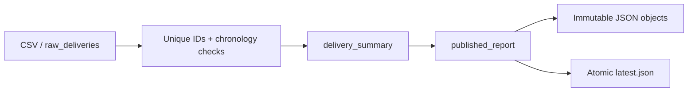

# Суточная витрина доставок — Dagster assets

Я сделал небольшой учебный конвейер: CSV доставок → две блокирующие проверки →
суточный отчёт по складам → проверяемый JSON. Дубликат или невозможное время
останавливают downstream; предыдущая опубликованная витрина остаётся доступной.
Я показываю сохранённую историю Dagster и восстановление после сбоя публикации.
Все данные синтетические; коммерческий опыт этому проекту не приписываю.

Новый основной инструмент — **Dagster1.13.27**. Я использую три assets, две
blocking checks, in-process execution и локальный event/run store. Cloud,
webserver, daemon, Docker и внешняя база для запуска не нужны.



## Как я запускаю за пять минут

Я использую Python3.12 и устанавливаю52универсальных pins из requirements.lock;
на Linux активны48, остальные4 относятся к Windows. Hashes фиксируют транзитивные
зависимости. В Linux:

```bash
python3.12 -m venv .venv
.venv/bin/python -m pip install --require-hashes -r requirements.lock
.venv/bin/python -m delivery_assets demo --directory workspace/demo
.venv/bin/python -m delivery_assets show --workdir workspace/demo/state
.venv/bin/python -m delivery_assets history --workdir workspace/demo/state
```

В Windows я создаю окружение через `py -3.12 -m venv .venv` и вызываю
`.venv\Scripts\python.exe` вместо `.venv/bin/python` в тех же командах.
Demo требует новый каталог; повторяю в workspace/demo2, не удаляя прежнюю историю.

Я получаю5Dagster runs: success,success,failure,failure,success; два immutable
объекта и итог5доставок:2вовремя,1с опозданием,2просрочены на конец суток.
В revised примере известное максимальное опоздание WH-A уменьшается с1200до300секунд.
ERROR в stderr двух намеренно сломанных запусков ожидаемы; demo завершается0,
только если блокировка и восстановление сработали. Обычный неуспешный run завершается2.

## Как я пробую отдельный пакет

```bash
.venv/bin/python -m delivery_assets generate --output workspace/input
.venv/bin/python -m delivery_assets run --input workspace/input/deliveries.csv --day 2026-10-26 --workdir workspace/state
.venv/bin/python -m delivery_assets generate --output workspace/bad --scenario duplicate
.venv/bin/python -m delivery_assets run --input workspace/bad/deliveries.csv --day 2026-10-26 --workdir workspace/state
.venv/bin/python -m delivery_assets show --workdir workspace/state
```

Последний run возвращает2: Dagster материализует только raw_deliveries, блокирующая
проверка не пропускает summary/publish. Show по-прежнему показывает хороший отчёт.
Сценарии generate: valid,duplicate,chronology,revised. Для учебного сбоя после
создания объекта перед latest добавляю run flag `--simulate-publish-failure`.
Повторяю без флага: orphan object используется повторно, latest продвигается.

## Как я проверяю проект

```bash
.venv/bin/python -m unittest discover -s tests -v
.venv/bin/python scripts/smoke.py
.venv/bin/python scripts/package_release.py
```

Локально я прошёл14tests и отдельный CLI smoke с6запусками, включая новый процесс
show/history, blocking check и сбой/повтор публикации. Windows и CI отмечаю только
после фактического прогона в [VALIDATION](VALIDATION.md); наличие workflow не успех.
ZIP собираю по PUBLIC_FILES.txt, без workspace,CSV,SQLite,окружения и личных файлов.
SHA256SUMS лежит рядом с архивом. Скачанный ZIP можно распаковать и выполнить те же
команды после установки dependencies; Git для работы приложения не требуется.

## Где я объясняю решения

- [START_HERE](START_HERE.md): карта файлов и маршрут изменения.
- [NOTES](NOTES.md): подробный разбор, ошибки, вопросы и5заданий с ответами.
- [CONCEPT](CONCEPT.md): договорённости и границы.
- [TECHNOLOGIES](TECHNOLOGIES.md): версии, назначение и все52pins.
- [VALIDATION](VALIDATION.md): только фактически выполненные проверки.

Я ограничил пакет1MB/10000строками и UTC секундами2020…2099. Warehouse — WH-A/WH-B.
Один workspace обслуживает один процесс. После жёсткого crash lock снимаю вручную
только убедившись, что процесс завершён; папка .run-lock не означает плохие данные.
Не заявляю HA, автоматическое расписание, графический Dagster UI, полноту внешнего
источника и сохранность при потере питания. JSON report и статус Dagster не входят
в общую транзакцию; подробности в NOTES. Runtime Dagster store доверенный, локальный.
